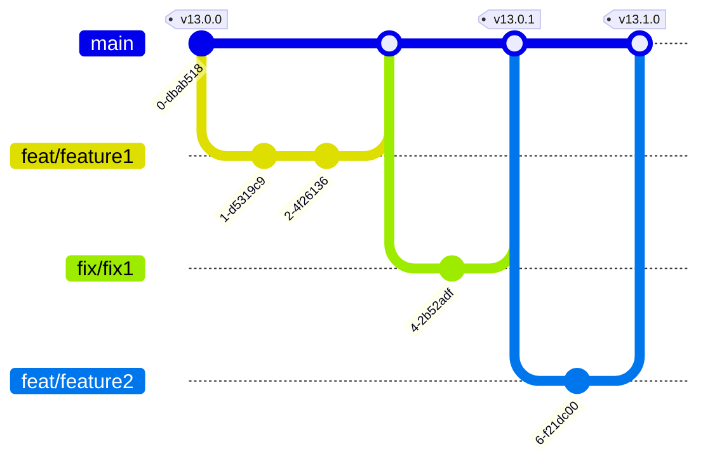
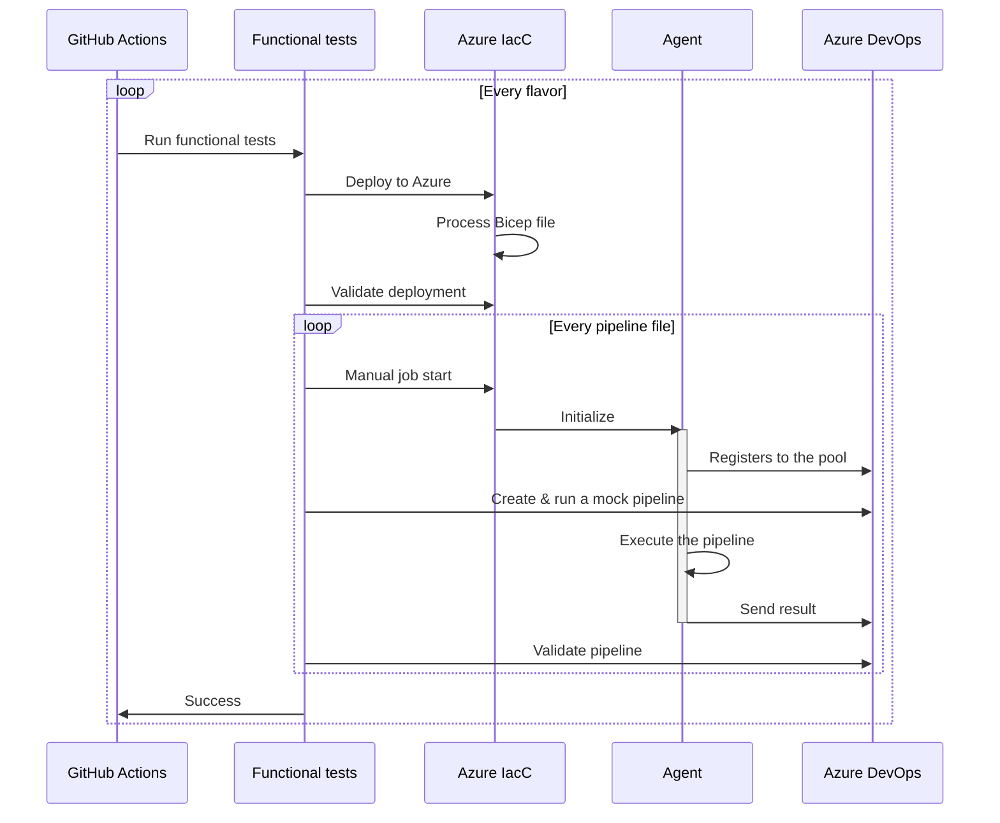

## Version control

Trunk-based development is used for version control. The trunk is `main`: feature branches are created from `main` and merged back through pull requests. A release is made by pushing a `vX.Y.Z` tag on `main`.

Version number is compliant to [Semantic Versioning](https://semver.org/) and dynamically generated by [gitops-version](https://github.com/KamorionLabs/gitops-version) (a fork of [clemlesne/gitops-version](https://github.com/clemlesne/gitops-version)): a tagged commit gets the tag version, any other commit gets a pre-release version derived from the latest tag (e.g. `13.0.0-4.3f2a1bc`).

Releases up to `v12.0.1` belong to the original project. Releases of this fork start at `v13.0.0`, the pipeline refuses to release a version below it or a version that also exists in the original project.

## Functional tests

Functional tests can run on every pull request and on every commit to the `main` branch. They are opt-in (repository variable `INTEGRATION_TESTS`), as they require an Azure subscription and an Azure DevOps organization. Azure DevOps is contacted to validate each pipeline run.

